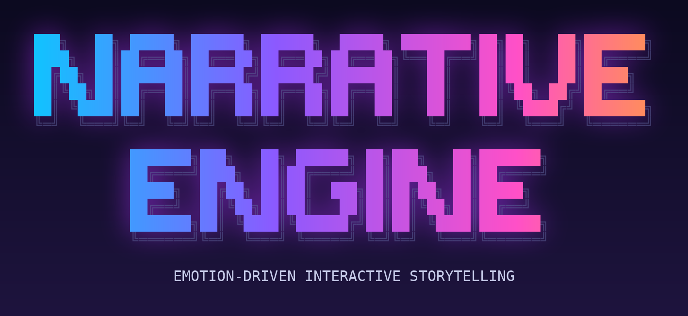
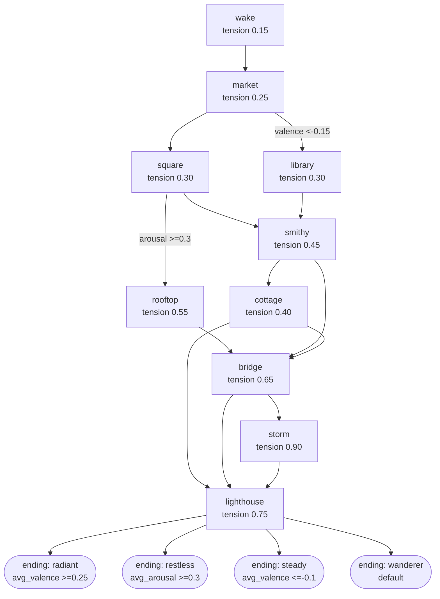

<div align="center">



# Narrative Engine

**A real-time story that reads your face through a webcam and adapts as you feel.**
Smile and the world warms up. Look sad and it turns gentle. No controller, just your expression.


</div>

<!-- TODO: record a 30-60 s demo (Windows: ScreenToGif, Mac: QuickTime + ffmpeg, Linux: Peek), save it as docs/demo.gif,
     then delete this comment and uncomment the line below. A visible demo is the single
     most effective thing on a GitHub project page.
<p align="center"></p>
-->

---

## What it does

The webcam feeds a perception pipeline that finds your face, estimates your mood, and smooths it over
time. A director layer uses that mood to pick which version of each story scene you see, while the
background colour, particles and character react to match.

- **Webcam is the only input**, nothing to learn.
- **A branching story graph** (10 scenes, 4 endings) with memory: what you earn early is referenced later.
- **A drama manager** that steers pacing along a tension curve, not just echoing your face.
- **Four mood variants per scene**, so the same story plays differently for different people.
- **Optional local-LLM narrator** (Ollama) that re-voices each scene for your mood, always with an authored fallback.
- **Fully local**: no video is stored or sent anywhere.
- **Continuous mood model**: valence (unhappy to happy) and arousal (calm to excited), not just labels.
- **Per-user calibration** so your resting face is not misread as an emotion.
- **Works out of the box** with a lightweight fallback; the recommended MediaPipe backend is one install away.

## Quick start

```bash
git clone https://github.com/alwin-mj/Procedural-Narrative-Engine.git
cd Procedural-Narrative-Engine

python -m venv .venv
source .venv/bin/activate            # Windows: .venv\Scripts\activate

pip install -e ".[mediapipe]"        # recommended: fast CPU face tracking + blendshapes
narrative-engine                     # or: python -m narrative_engine
```

Press **S** to start (with MediaPipe you will be asked to hold a neutral face for 3 seconds), **C** to recalibrate,
**SPACE** for the next scene, **Q** to quit.

### Detector backends

| Backend | Install | Notes |
|---|---|---|
| `mediapipe` (recommended) | `pip install -e ".[mediapipe]"` | ~5 ms/frame on CPU, 52 face blendshapes, supports calibration |
| `fer` | `pip install -e ".[fer]"` | TensorFlow-based, large |
| `deepface` | `pip install -e ".[deepface]"` | TensorFlow-based, large |
| `haar` | included | smile cue only (smile = happy, otherwise neutral) |

`--backend auto` (default) tries MediaPipe, then FER, then DeepFace, then Haar. A backend that is missing or
fails to load is skipped with a warning, so the app always starts. The detector in use is shown on screen.

> **One-time download:** the MediaPipe backend fetches a ~4 MB model (`face_landmarker.task`) on first run and
> caches it in `~/.cache/narrative-engine/`. This is the only network access the project makes. For fully
> offline use, download the file yourself and pass `--mp-model path/to/face_landmarker.task`.

## How it works

```
Webcam -> Detector backend -> Affect model -> Smoothing -> Director -> GameWindow
          (MediaPipe /        (blendshapes    (rolling avg,  (story +    (gradient, particles,
           FER / DeepFace /    -> valence,     hysteresis,    mood        character, HUD, text)
           Haar)               arousal)        EMA)           selection)
```

1. OpenCV grabs a mirrored frame.
2. The active backend finds the face. With MediaPipe, 52 blendshape scores (smile, brow raise, jaw open...)
   are collapsed into nine interpretable features (`perception/affect.py`).
3. **Calibration** records your neutral face for 3 s and subtracts it, so a naturally "resting smile" or a
   heavy brow is not read as an emotion.
4. Features become **valence** (-1 unhappy to +1 happy) and **arousal** (0 calm to 1 excited), then a soft
   distribution over the four story moods (`happy`, `uplift`, `sad`, `neutral`). FER/DeepFace results are
   mapped onto the same valence/arousal plane using the Russell circumplex model.
5. **Smoothing** averages recent frames, a **hysteresis gate** stops the mood flipping on near-ties (a new
   mood must win by a margin for several frames), and valence/arousal use an exponential moving average.
   With no face, they decay toward neutral instead of freezing.
6. Every few seconds, if a face is visible and confidence is high enough, the **drama manager** picks the next
   scene (see below) and the mood variant (`director/selector.py`). A mood change must persist for 0.8 s before
   the "A shift: you seem..." line appears, and it never delays the next scene.
7. `GameWindow` renders everything, including a valence/arousal pad and a one-line explanation of the
   director's last decision.

The valence/arousal weights are heuristics, not a trained model. They live in one dataclass
(`AffectWeights`) so they can be tuned and measured.

## The story engine

The story is a **graph**, not a list. Scenes are nodes with a *tension* (0 = calm, 1 = intense); edges can
carry conditions on your affect and on story state.



(Generate this yourself with `narrative-story mermaid`.)

**Drama manager.** Think of a game master who knows how tense the story *should* be right now (a curve that
rises, peaks near the end, then resolves). Edges whose conditions hold are the legal next scenes; the manager
picks the one whose tension best matches the goal, nudged by how you are doing:

| Viewer state | Detected as | Manager reaction |
|---|---|---|
| flat / bored | neutral face, low arousal for the whole scene | aim for **higher** tension |
| engaged | anything in between | follow the curve |
| overwhelmed | very high arousal | aim for **lower** tension |

Every decision comes with a reason, shown on screen and logged, e.g.
`viewer flat (V+0.02 A0.05) -> aim higher; want tension 0.62; smithy->bridge (0.65) over cottage(0.40)`.

**Story state.** Flags (items, facts), character relationships and visited scenes carry over. Happy at the
smithy earns a pendant that is mentioned again at the bridge and lighthouse; the folktale from the library pays
off at the end.

**Endings** are chosen from your whole emotional trajectory (average valence/arousal over the playthrough):
`radiant`, `restless`, `steady`, or the default `wanderer`.

**Evaluation baselines.** `--mode fixed` always plays the default route in neutral wording; `--mode random`
picks random routes and variants. Together with `--mode adaptive` (default) they are the three conditions for
a user study.

## Optional: local LLM narrator

With [Ollama](https://ollama.com) running locally (`ollama pull llama3.2`), run:

```bash
narrative-engine --llm llama3.2
```

The model re-tells each scene in a tone that fits your mood. The authored text is the source of truth for plot
facts and is shown immediately; the LLM version replaces it when ready. Design points:

- Runs on a **background thread**, so the camera and UI never wait.
- The next scenes are **prefetched** while you read, so text is usually ready on arrival.
- Output is checked (length, protagonist present, no lists or chatty preambles); bad output is discarded.
- Failures and timeouts fall back to the authored text and are counted (`LLM stats` are logged on exit,
  including the fallback rate). After 3 consecutive failures it pauses for 30 s.
- First request gets extra time to load the model; later ones use `--llm-timeout` (default 6 s, CPU-friendly).

Nothing is sent anywhere except to your own Ollama server (`--llm-host`).

## Project structure

```
.
├── pyproject.toml
├── requirements.txt / requirements-optional.txt / requirements-dev.txt
├── src/narrative_engine/
│   ├── __main__.py          CLI entry point
│   ├── app.py               main loop and per-frame logic
│   ├── config.py            all tunable settings + CLI flags
│   ├── perception/
│   │   ├── detector.py      backend chain, calibration, smoothing pipeline
│   │   ├── mediapipe_backend.py  MediaPipe Face Landmarker wrapper + model download
│   │   ├── affect.py        blendshapes -> valence/arousal -> mood scores
│   │   ├── smoothing.py     rolling average, EMA, hysteresis gate
│   │   └── motion.py        "walking" detection (face movement or frame difference)
│   ├── story_tool.py        `narrative-story check|mermaid`
│   ├── director/
│   │   ├── graph.py         story graph, conditions, validation, JSON loading
│   │   ├── session.py       a playthrough: current scene, flags, relations, trajectory
│   │   ├── drama.py         tension curve + drama manager (+ fixed/random baselines)
│   │   ├── realizer.py      authored / Ollama text, output checks, async worker
│   │   └── selector.py      which mood variant to use on advance
│   ├── render/
│   │   ├── window.py        background, particles, HUD, text
│   │   └── player_animation.py
│   └── data/stories/arin_adventure.json
├── tests/
└── docs/
```

## Command-line options

| Flag | Default | Meaning |
|---|---|---|
| `--camera N` | `0` | camera index |
| `--backend` | `auto` | `auto`, `mediapipe`, `fer`, `deepface`, `haar` |
| `--mp-model PATH` | cached download | local `face_landmarker.task` (offline use) |
| `--no-calibration` | off | skip the neutral-face calibration on start |
| `--motion-mode` | `face` | `face` (face-box movement) or `frame` (whole-frame difference) |
| `--story PATH` | bundled | path to a story JSON file |
| `--sprites DIR` | none | folder of PNG frames to replace the default orb |
| `--interval S` | `3.5` | seconds between automatic scene changes |
| `--min-confidence X` | `0.25` | confidence needed to advance |
| `--motion-threshold X` | `0.03` (`face`) / `7.0` (`frame`) | walking sensitivity |
| `--mood-bias X` | `0` | extra "happy" score on neutral/sad readings (0 = off; 0.25 = original prototype) |
| `--mode` | `adaptive` | `adaptive`, or the `fixed` / `random` evaluation baselines |
| `--llm MODEL` | off | rewrite scenes with a local Ollama model |
| `--llm-host URL` | `http://localhost:11434` | Ollama server |
| `--llm-timeout S` | `6` | seconds per LLM request |
| `--width / --height` | `960 / 540` | window size |
| `--log-level` | `INFO` | `DEBUG`, `INFO`, `WARNING`, `ERROR` |

Defaults live in `src/narrative_engine/config.py`.

## Writing your own story

Stories are JSON. Copy `src/narrative_engine/data/stories/arin_adventure.json`, edit it, then check it:

```bash
narrative-story check my_story.json      # validates and prints a summary
narrative-story mermaid my_story.json    # draws the graph
narrative-engine --story my_story.json
```

```json
{
  "title": "My Story",
  "protagonist": "Mira",
  "start": "intro",
  "scenes": [
    {
      "id": "intro",
      "location": "harbour",
      "tension": 0.2,
      "variants": {"neutral": "...", "happy": "...", "uplift": "...", "sad": "..."},
      "effects":   [{"when": {"mood": "happy"}, "set_flags": ["lantern"], "relations": {"sailor": 1}}],
      "callbacks": [{"if": {"flag": "lantern"}, "text": "Her lantern glows."}],
      "next": [
        {"to": "cliff", "when": {"arousal": ">=0.3"}},
        {"to": "beach"}
      ]
    }
  ],
  "endings": [
    {"id": "bright", "when": {"avg_valence": ">=0.25"}, "text": "..."},
    {"id": "default", "text": "..."}
  ]
}
```

Rules (all checked on load, with clear errors): every scene has a non-empty line for all four moods; tension is
0 to 1; every scene with `next` has at least one edge **without** `when` (no dead ends); no cycles; every scene
is reachable; the last ending has no `when`. A scene without `next` is terminal.

Condition keys (all must hold): `mood`, `valence`, `arousal`, `avg_valence`, `avg_arousal` (comparators like
`">=0.3"`, or a list for a range), `flag`, `not_flag`, `visited`, `not_visited`, `relation`.
The older linear format (`scenes` + one `ending` string) still loads.

## Custom character

By default the character is a glowing orb that moves faster when you move. To use your own sprite, put
transparent PNG frames in a folder (loaded alphabetically, resized to 160x160) and run
`narrative-engine --sprites path/to/frames`.

## Development

```bash
pip install -e ".[dev]"
pytest                    # unit tests
ruff check .              # lint
black .                   # format
```

## Troubleshooting

| Problem | Fix |
|---|---|
| "Cannot open camera" | Close other apps using the webcam, or pass `--camera 1`. |
| Mood always `NEUTRAL` | Check `detector:` on screen. `haar` or `none` means no ML backend is active: install `.[mediapipe]`. Face a light source, move closer, and press **C** to recalibrate. |
| "MediaPipe backend unavailable: could not download..." | You are offline or blocked. Download `face_landmarker.task` (URL is in the log message) and run with `--mp-model`. |
| `pip` complains about `numpy` or OpenCV versions after installing MediaPipe | Use a fresh virtual environment. MediaPipe depends on `opencv-contrib-python`; if two OpenCV packages conflict, run `pip uninstall -y opencv-python opencv-contrib-python` then `pip install opencv-contrib-python`. |
| Mood flickers or feels sluggish | Tune `hysteresis_frames`, `smoothing_window` and `affect_smoothing` in `config.py`. |
| `--llm` does nothing | Check that Ollama is running (`ollama list`) and the model name matches. Look for "LLM stats" on exit: a fallback rate near 1.0 means requests are failing or timing out; try a smaller model or a larger `--llm-timeout`. |
| Slow first frames (FER/DeepFace) | They load large models at startup. Use MediaPipe or `--backend haar`. |

## Limitations and privacy

- All processing is **local**. No video or images are stored or transmitted. The only network access is the
  one-time MediaPipe model download (skippable with `--mp-model`).
- Facial expression is not the same as inner emotion. Models can misread people, lighting, glasses and
  camera angles, and accuracy varies across demographics. Treat this as an interaction mechanic, not a
  measure of how someone feels.
- Valence/arousal weights are hand-set heuristics and have **not yet been evaluated** against labelled data.
  Arousal from faces is a weak signal; expect it to be noisier than valence.
- Reading text can furrow the brow, which may nudge the reading toward "sad". Calibration helps but does not
  remove this.
- The drama manager's rules (what counts as "bored") are hand-set heuristics and have not yet been validated
  with a user study.
- LLM output can still drift in style; the authored text is always the fallback and the plot-fact anchor.
- Designed for one face, one viewer, entertainment use only.

## Roadmap

- [x] Package layout, centralised config, CLI, JSON stories
- [x] MediaPipe blendshape detector, continuous valence/arousal, per-user calibration, hysteresis
- [x] Face-movement based "walking" detection
- [x] Story graph with branching, story state, trajectory-based endings
- [x] Drama manager (tension curve, viewer-state adaptation, explainable decisions)
- [x] Optional local-LLM narrator with prefetch, output checks and authored fallback
- [x] `fixed` / `random` baseline modes for evaluation
- [ ] Threaded perception (no frame stalls)
- [ ] Benchmarks, classifier evaluation and a small user study
- [ ] CI

## Team

| Name | GitHub |
|---|---|
| Alwin John Shajan | [@AlwinJCOde667](https://github.com/AlwinJCOde667) |
| Alwin M J | [@alwin-mj](https://github.com/alwin-mj) |

B.Tech Computer Science & Engineering, Sahrdaya College of Engineering and Technology.

## License

MIT, see [LICENSE](LICENSE).
