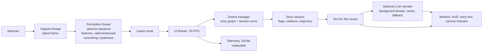
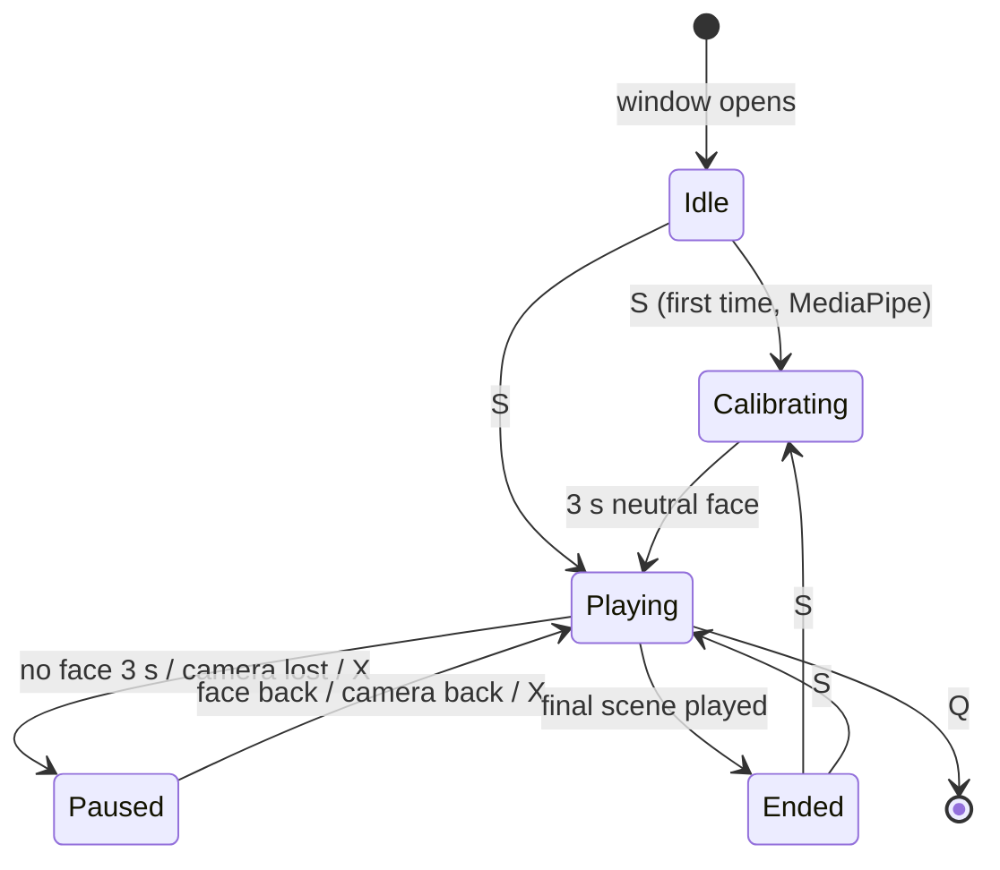

# Architecture and design decisions

A map of how the pieces fit together, why they are built this way, and what each choice costs. Written
to be read before an interview or before changing the code.

## 1. The big picture



| Layer | Modules | Responsibility |
|---|---|---|
| Input | `pipeline.py` (`CameraSource`, `VideoFileSource`, `ReconnectingSource`, `FrameGrabber`) | Get frames, survive a flaky camera, honour camera-off |
| Perception | `perception/` (`detector`, `mediapipe_backend`, `affect`, `smoothing`, `motion`) | Frames to a stable mood plus valence/arousal |
| Director | `director/` (`graph`, `session`, `drama`, `selector`, `realizer`) | Decide what happens next and what text to show |
| App | `app.py`, `config.py`, `__main__.py`, `consent.py` | Wire everything, run the loops, own the user-facing rules |
| Render | `render/` | Draw one frame |
| Measurement | `telemetry.py`, `evaluation.py`, `study.py`, `eval_cli.py`, `demo.py` | Logs, replay, benchmarks, accuracy, the user study, the demo GIF |

## 2. Threads and data flow

```
Capture thread     read -> [latest frame slot] ----------------+
                                                                v
Perception thread  newest frame -> shrink -> detect -> smooth -> [latest result slot]
                    (<= 15 Hz, old frames dropped)                       |
                                                                         v
UI thread          read both slots -> degrade if stale -> director -> render (~30 FPS)
```

- Each hand-off is a **single "latest value" slot, not a queue**. If the detector is slower than the camera,
  frames are skipped and latency stays bounded instead of growing.
- Smoothing, motion and scene statistics advance **once per detector reading**, not once per drawn frame
  (otherwise a 30 FPS renderer repeating a 15 Hz result would halve the apparent motion).
- The detector is only called from the perception thread; the small amount of state the UI thread touches
  (calibration, resets) is guarded by a lock.

## 3. What the UI is doing



"Paused" always holds the scene timer, so nothing advances while the viewer is gone and the scene gets its
full time when they return.

## 4. Perception: from pixels to a mood

1. A backend finds the face. Chain: MediaPipe, FER, DeepFace, then Haar (every ML backend is optional, so the
   app always starts).
2. MediaPipe's 52 blendshape scores are collapsed to nine features (smile, cheek, frown, brow up/down, eyes
   wide, jaw open, sneer, press).
3. Per-user **calibration** subtracts the median of a neutral take, and rescales so a full expression can still
   reach 1.
4. A hand-set linear map gives **valence** (-1..1) and **arousal** (0..1); `scores_from_affect` turns them
   into a soft distribution over four story moods.
5. **Rolling average** (6 of the last 10 readings), then a **hysteresis gate** (a new mood must win by 0.08 for
   3 readings), then an **EMA** on valence and arousal. With no face, they decay toward neutral.

## 5. The director

- A story is a **directed acyclic graph** in JSON. Loading rejects dead ends, cycles, unreachable scenes,
  missing mood lines and a missing default ending, so every playthrough terminates.
- Edges carry conditions on the viewer (valence, arousal, mood), on **story state** (flags, relationships,
  visited scenes) and on the whole **trajectory** (average valence/arousal) for endings.
- The **drama manager** knows a target tension curve (rise, peak near the end, resolve). Among the legal next
  scenes it picks the one whose tension is closest to the goal, shifted up for a flat/bored viewer and down for
  an overwhelmed one. Ties go to the first listed edge, so it is deterministic. Every decision carries a
  human-readable reason.
- The **mood variant** of the text comes from a separate, tiny selector; its optional bias toward "happy" is
  **off by default** because it manipulates the signal.
- Baselines for evaluation: `fixed` (always the default route, neutral wording) and `random`.

## 6. The optional LLM narrator

The authored text is the source of truth. The LLM only re-voices it, on a background thread, with a cache and
prefetch of the likely next scenes. The UI never waits: the authored line shows immediately and is swapped when
the model answers. Output is checked (length, lists, preambles, refusals, markdown, and the hero's name when the
scene names him). Errors (server down, timeout) and rejections (the model answered badly) are counted
separately; only repeated errors pause the narrator.

## 7. Design decisions and their costs

| Decision | Alternative | Why this | What it costs |
|---|---|---|---|
| Latest-value slots between threads | Bounded queues | Bounded latency; always processes the newest data | Skips frames; the detector never sees every frame |
| Hand-set valence/arousal from blendshapes | Train a classifier | Explainable, tunable, no training data needed | Not validated across people; accuracy is whatever you measure |
| Story as a validated DAG in JSON | Code or free-form scripting | Authors can edit data; termination is guaranteed; testable | Less expressive than a scripting language |
| Tension curve + viewer state | React to the face only | Pacing instead of mere echoing; explainable | The "bored" threshold is a heuristic |
| Authored text first, LLM optional | LLM-generated story | Works offline, deterministic, safe fallback | Less variety without the LLM |
| Everything local, opt-in saving | Cloud inference or logging | Privacy by default, no accounts | Cannot scale or aggregate across users |
| Simulated-clock replay | Real-time replay only | Deterministic, fast, enables policy comparison | Replayed viewers cannot react to a different story |
| Dependency injection (detector, clock, realizer, source) | Hard-wired components | The whole app is testable without hardware | A few extra parameters |
| Smoothing + hysteresis | Raw per-frame mood | Stable mood on a noisy signal | A measurable reaction delay (the tools report it) |
| Exact paired permutation test in the study | t-test | Few assumptions for tiny, ordinal samples | Only large effects are detectable with 6 to 12 people |

## 8. Failure handling

| Failure | Behaviour |
|---|---|
| Detector slow or stalled | Keep the last mood, decay valence/arousal, mark LAGGING; after 2 s treat the face as gone |
| No face for 3 s | Pause the story and say so |
| Camera stops delivering frames | Message, pause, retry opening every 2 s |
| Camera switched off with X | Device released, story paused, resumes cleanly |
| Optional backend missing | Skipped with a log line; next backend in the chain |
| MediaPipe model download fails | Fall back to the next backend; `--mp-model` for offline use |
| LLM down, slow or unhelpful | Authored text, with counters and a pause after repeated errors |
| Telemetry or recording cannot be written | Logged and disabled; the experience continues |
| Window closed, Q, Ctrl+C, an exception | Threads joined, camera released |

## 9. How it is tested

About four hundred tests, none needing a camera, a model, TensorFlow or an LLM. They use fake detectors and
cameras (including ones that fail and reconnect), a real local HTTP server standing in for Ollama, synthetic
videos replayed through the real command line in a subprocess, and checks that guard the repository itself
(for example that no module is left importing nothing). CI runs lint and the suite on Python 3.10 to 3.12 with a
coverage floor. See [evaluation.md](evaluation.md) for how accuracy and latency are measured on real data.

## 10. Extending it

- **A new story**: copy `starter.json`, edit, run `narrative-story check --strict`. No code changes.
- **A new detector backend**: return a `Detection` from a `_run_<name>` method and add it to the chain.
- **A different director policy**: implement `decide` returning a `Decision` and compare it against the others
  on recorded sessions with `narrative-eval counterfactual`.
- **A new signal** (gaze, audio): add its features and fold them into `estimate_affect`.

## 11. Known limits and what I would do next

- The affect weights are heuristics; measure them (and tune on held-out takes), or train a small model with
  leave-one-take-out validation.
- Only one face and one viewer.
- An engagement-only mode (head pose, blink) that never labels an expression.
- A browser version running the model client-side, so no video ever leaves the device.
- Learning the director's choices from many sessions (a contextual bandit), once there is enough study data.
